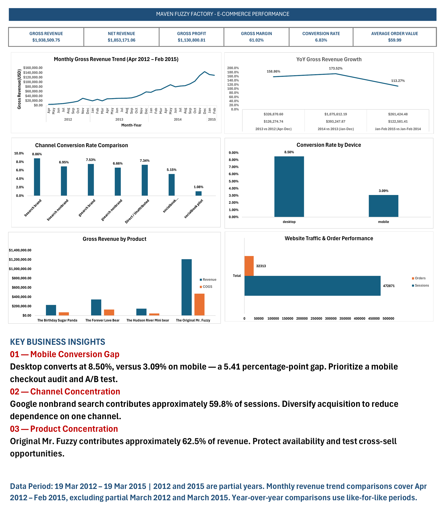

# Maven Fuzzy Factory: E-commerce Analytics (Excel + Power BI)

An end-to-end analysis of an online toy retailer's website traffic, conversion funnel, marketing channels, products and refunds. Built in **Excel** (KPI workbook with pivot analysis and reconciliation checks) and **Power BI** (multi-page interactive report).


**Author:** Varsani A | [GitHub](https://github.com/varshaanbu3107-afk) | LinkedIn: _add your profile link_
**Data:** Maven Analytics "Maven Fuzzy Factory" sample dataset (a fictional company), 19 Mar 2012 to 19 Mar 2015
**Scale:** 472,871 website sessions and 32,313 orders

---

## Business questions

1. How is the business performing overall (revenue, profit, margin, conversion, order value)?
2. Where do visitors drop off in the funnel (landing, product, cart, billing, order)?
3. Which marketing channels bring the most traffic, and which convert best?
4. How do desktop and mobile compare, and how do new and repeat sessions compare?
5. Which products drive revenue, and where do refunds concentrate?
6. What should the business do next?

## Headline findings

| # | Finding | Evidence |
|---|---|---|
| 1 | **Mobile converts far below desktop** | 3.09% vs 8.50% (a 5.41-point gap) |
| 2 | **One channel carries the business** | gsearch nonbrand: 59.8% of sessions, 58.2% of orders, converts at 6.66% vs 6.83% overall |
| 3 | **The weakest funnel step is Product to Cart** | 55.2% (session to product), **36.3%** (product to cart), 54.8% (cart to billing), 62.1% (billing to order). Only 6.8% of sessions end in an order |
| 4 | **Landing pages differ widely** | /lander-5 converts at 10.2% vs 3.4% for /lander-3 (see limitations: the pages may not have run over the same dates) |
| 5 | **Refunds are concentrated in one product** | The Original Mr. Fuzzy: 62.5% of revenue but 72.46% of refund dollars ($61,838 of $85,339). Birthday Sugar Panda has the highest item refund rate (6.04%) |
| 6 | **The socialbook pilot underperformed** | 1.08% conversion (55 orders from 5,095 sessions). There is no spend data, so ROI cannot be calculated |
| 7 | **Repeat sessions convert somewhat better** | 7.83% vs 6.64% for new sessions; net revenue per session $4.54 vs $3.80 (association only, cause not tested) |
| 8 | **Strong growth** | Gross revenue +173.52% in 2014 vs 2013; peak month Dec 2014 ($144,823) |

### Illustrative estimates (not forecasts)

These are simple what-if calculations from this dataset, labeled **illustrative**:

| Scenario | Calculation | Result |
|---|---|---|
| Mobile conversion reaches 4.5% | 145,844 mobile sessions x (4.5% - 3.09%) x $59.99 AOV | about +2,055 orders, about $123K |
| gsearch nonbrand conversion +0.5 point | 282,706 sessions x 0.5% x $59.99 AOV | about 1,400 orders, about $85K |
| Mr. Fuzzy refund rate matches Forever Love Bear's (2.23%) | $1,211,058 revenue x (5.11% - 2.23%) | about $35K |

## Dashboard preview

**Power BI report** (full-resolution images in `Screenshots/PowerBI/`; vector PDF in `Report/`)

| Page | Preview |
|---|---|
| Executive Overview | [02_Executive_Overview.png](Screenshots/PowerBI/02_Executive_Overview.png) |
| Marketing and Channels | [03_Marketing_and_Channels.png](Screenshots/PowerBI/03_Marketing_and_Channels.png) |
| Website Funnel | [04_Website_Funnel.png](Screenshots/PowerBI/04_Website_Funnel.png) |
| Products and Refunds | [05_Products_and_Refunds.png](Screenshots/PowerBI/05_Products_and_Refunds.png) |
| Customer and Device | [06_Customer_and_Device.png](Screenshots/PowerBI/06_Customer_and_Device.png) |
| Insights and Recommendations | [07_Insights_and_Recommendations.png](Screenshots/PowerBI/07_Insights_and_Recommendations.png) |

The report also contains a Channel Tooltip page and a Product Drill-Through page (hidden pages, not shown in the images).

**Excel workbook** (images in `Screenshots/Excel/`): Dashboard, KPI Summary, Device, Product Performance, Order and Refund, Monthly Trend, YoY, Data Quality Checks, README sheet.



## Tools and skills

- **Excel:** pivot tables, charts, KPI summary, reconciliation checks, documentation sheet
- **Power BI:** data modeling (date table, funnel stage table), DAX measures, multi-page report, slicers, page navigation, tooltip and drill-through pages
- **Analysis:** funnel analysis, channel and device comparison, product and refund analysis, like-for-like year-over-year comparison, partial-period handling

## Metric definitions

| Metric | Definition |
|---|---|
| Gross Revenue | Sum of item prices |
| Net Revenue | Gross Revenue - Refunds |
| Gross Profit | Net Revenue - COGS |
| Gross Margin | Gross Profit / Net Revenue |
| Conversion Rate | Orders / Sessions |
| AOV (Average Order Value) | Gross Revenue / Orders |
| Refund Rate (items) | Refunded items / items sold |
| Refunds % of Revenue | Refund amount / Gross Revenue |
| Items per order | Items sold / Orders |
| Net Revenue per Session | Net Revenue / Sessions |

Key totals: Gross Revenue $1,938,509.75, Net Revenue $1,853,171.06, COGS $722,370.25, Refunds $85,338.69, Gross Profit $1,130,800.81, Gross Margin 61.02%, Conversion 6.83%, AOV $59.99, Refund rate (items) 4.32%, Refunds % of revenue 4.40%.

Full definitions and the data dictionary are in [`Docs/DATA_DICTIONARY_AND_ASSUMPTIONS.md`](Docs/DATA_DICTIONARY_AND_ASSUMPTIONS.md).

## Assumptions and limitations

- **Partial periods:** the data runs 19 Mar 2012 to 19 Mar 2015, so March 2012 and March 2015 are partial months. Monthly trends use full months only (Apr 2012 to Feb 2015).
- **Like-for-like YoY:** 2013 vs 2012 compares Apr to Dec only (+158.86%); 2014 vs 2013 is a full year (+173.52%); Jan to Feb 2015 vs Jan to Feb 2014 is +113.27%. 2012 growth is not shown (no 2011 data).
- **Gross profit** is Net Revenue minus COGS. This assumes COGS is not recovered on refunded items (unverified against the source data).
- **No ad-spend data**, so channel ROI cannot be calculated.
- **Observational data:** device, channel and landing-page differences are associations. Channel mix may partly explain the device gap (not tested).
- **Landing-page comparison** may not be like-for-like if pages ran in different periods (unverified).
- **Data quality checks** in the workbook are internal reconciliation checks (totals agree across sheets). They are not an independent audit of the raw data.
- The dataset is a sample/fictional company, so findings illustrate method rather than real business results.

## How to open the files

> Large files are stored in **GitHub Releases** (not in the folders): _add your Release link here after publishing_.

- **Power BI report** (`Maven_Fuzzy_Factory_Analytics_FINAL.pbix`, about 55 MB): open with [Power BI Desktop](https://powerbi.microsoft.com/desktop/) (free, Windows). The data is stored inside the file. The report was built from local file paths, so to refresh from source you must repoint them under **Home > Transform data > Data source settings**.
- **Excel workbook** (`Maven_Fuzzy_Factory_Analysis_Final.xlsx`, about 97 MB): open in desktop Excel. A yellow "External Data Connections have been disabled" banner is expected.
- **No software?** Use the PDF in `Report/` and the images in `Screenshots/`.

## Repository structure

```
maven-fuzzy-factory-ecommerce-analytics/
|-- README.md
|-- Docs/
|   `-- DATA_DICTIONARY_AND_ASSUMPTIONS.md
|-- Report/
|   |-- Maven_Fuzzy_Factory_Power_BI_Report.pdf
|   `-- Maven_Fuzzy_Factory_LinkedIn_Carousel.pdf
|-- Screenshots/
|   |-- PowerBI/   (7 report pages)
|   `-- Excel/     (9 workbook sheets)
`-- Releases (large files)
    |-- Maven_Fuzzy_Factory_Analytics_FINAL.pbix
    `-- Maven_Fuzzy_Factory_Analysis_Final.xlsx
```

## Dataset credit

Data: **Maven Analytics**, Maven Fuzzy Factory sample database (fictional online retailer). See the [Maven Analytics Data Playground](https://www.mavenanalytics.io/data-playground). The raw data is not included in this repository. Check the dataset's terms on Maven Analytics before redistributing it.

## What I would do next

- Basket analysis (the data has a primary-item flag) to test cross-sell ideas
- Refund trend by month, to see whether refunds spiked at a point in time
- Compare landing pages over identical date windows
- Break the mobile gap down by channel to separate device from channel-mix effects
- Replace the workbook's internal checks with comparisons against the raw source files

---
_Questions or feedback are welcome. Connect with me on LinkedIn._
