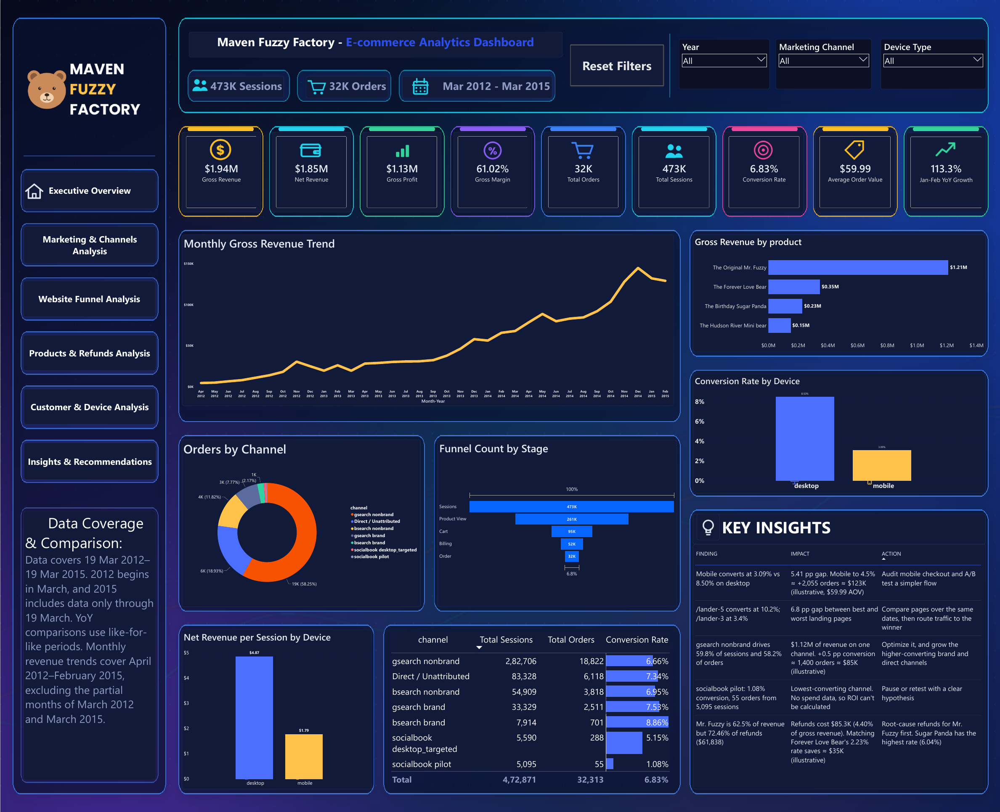
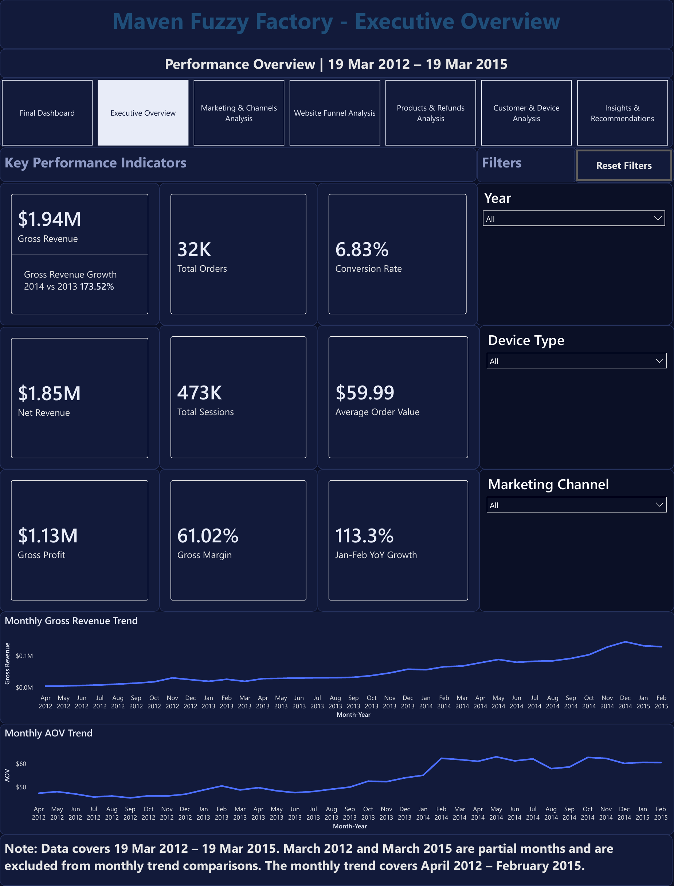
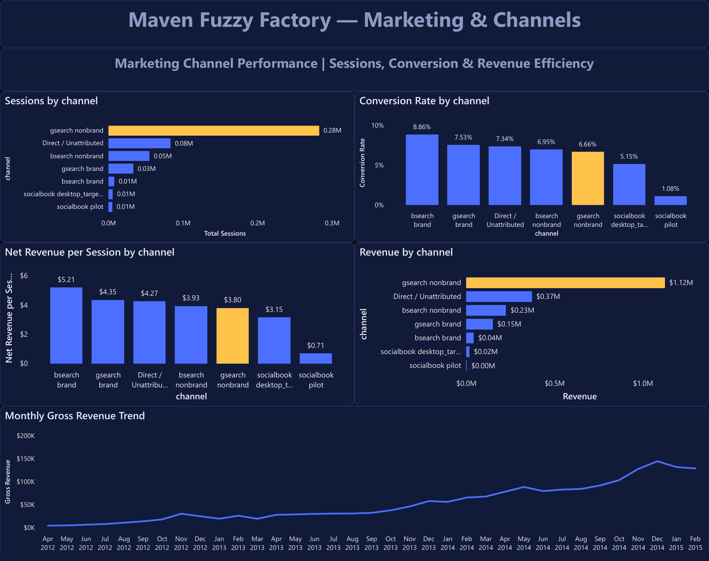
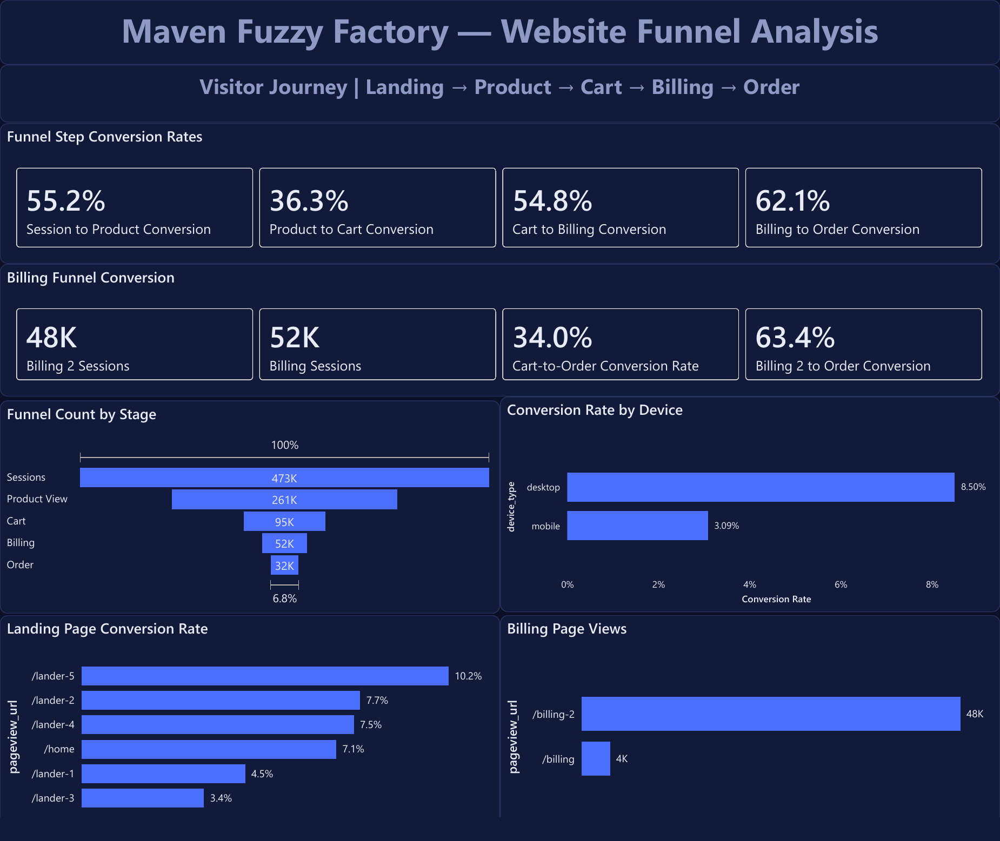
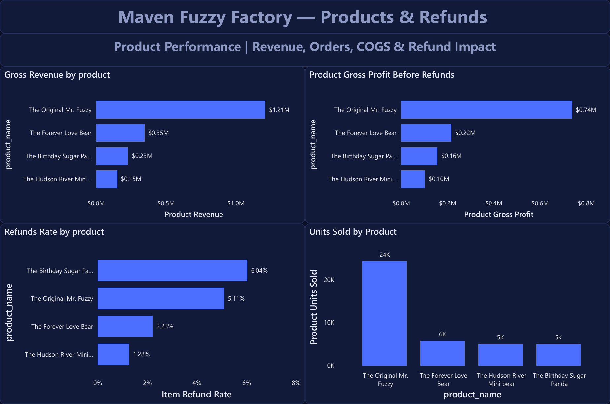
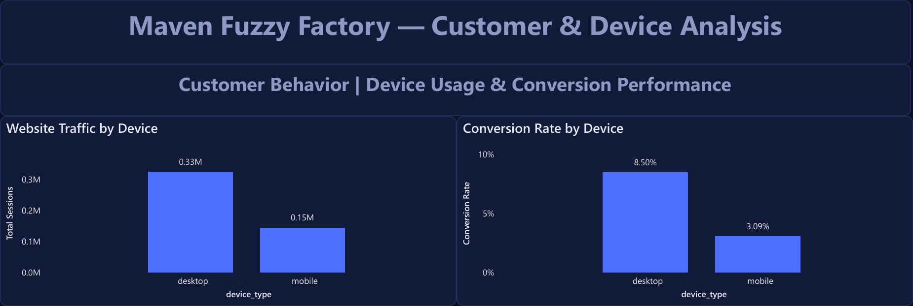
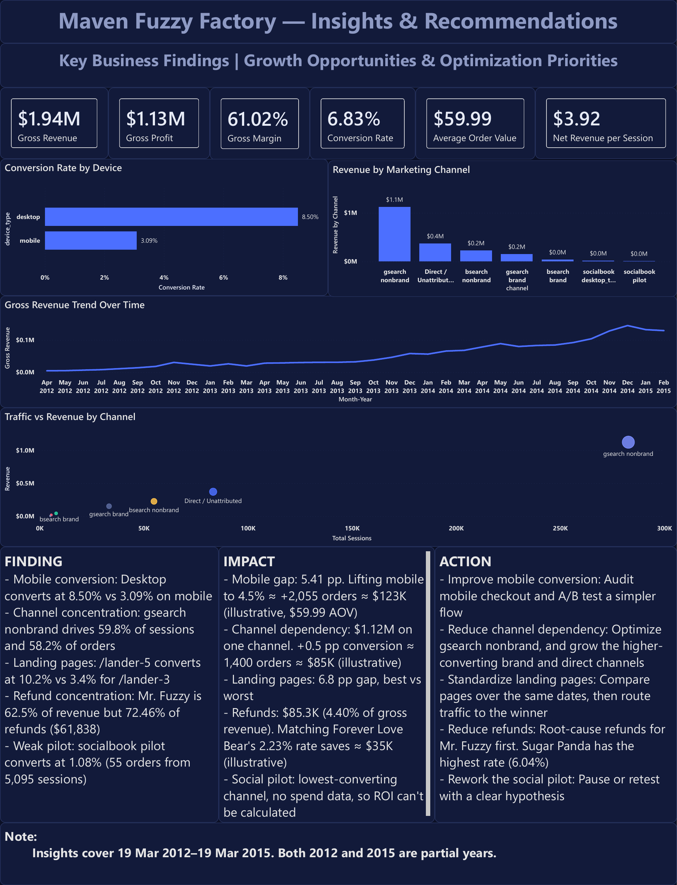

<div align="center">

# Maven Fuzzy Factory
### E-commerce Analytics in Excel and Power BI

*Where does the funnel leak, which channels carry the business, and where do refunds concentrate?*


[Dashboard gallery](#dashboard-gallery) &nbsp;|&nbsp; [Key findings](#key-findings) &nbsp;|&nbsp; [Download the files](#get-the-files) &nbsp;|&nbsp; [Data dictionary](Docs/DATA_DICTIONARY_AND_ASSUMPTIONS.md) &nbsp;|&nbsp; [LinkedIn carousel](Report/Maven_Fuzzy_Factory_LinkedIn_Carousel.pdf)



</div>

---

## Contents

1. [Project at a glance](#project-at-a-glance)
2. [Business questions](#business-questions)
3. [Key findings](#key-findings)
4. [Recommended actions](#recommended-actions)
5. [Dashboard gallery](#dashboard-gallery)
6. [How the analysis was done](#how-the-analysis-was-done)
7. [Skills demonstrated](#skills-demonstrated)
8. [Assumptions and limitations](#assumptions-and-limitations)
9. [Get the files](#get-the-files)
10. [Repository structure](#repository-structure)
11. [Dataset credit](#dataset-credit)
12. [What I would do next](#what-i-would-do-next)

---

## Project at a glance

An end-to-end analysis of an online toy retailer's website traffic, conversion funnel, marketing channels, products and refunds. The work is delivered as a **Power BI report** (7 interactive pages) and an **Excel KPI workbook** (pivot analysis and reconciliation checks).

**Period:** 19 Mar 2012 to 19 Mar 2015 &nbsp;|&nbsp; **Author:** Varsani A &nbsp;|&nbsp; [GitHub](https://github.com/varshaanbu3107-afk) &nbsp;|&nbsp; [LinkedIn](https://www.linkedin.com/in/a-varsani/)

| Gross revenue | Net revenue | Gross profit | Gross margin |
|:---:|:---:|:---:|:---:|
| **$1.94M** | **$1.85M** | **$1.13M** | **61.02%** |

| Sessions | Orders | Conversion rate | Average order value |
|:---:|:---:|:---:|:---:|
| **472,871** | **32,313** | **6.83%** | **$59.99** |

---

## Business questions

1. How is the business performing overall (revenue, profit, margin, conversion, order value)?
2. Where do visitors drop off in the funnel (landing, product, cart, billing, order)?
3. Which marketing channels bring the most traffic, and which convert best?
4. How do desktop and mobile compare, and how do new and repeat sessions compare?
5. Which products drive revenue, and where do refunds concentrate?
6. What should the business do next?

---

## Key findings

| # | Finding | Evidence |
|:---:|---|---|
| 1 | **Mobile converts far below desktop** | 3.09% vs 8.50% (a 5.41-point gap) |
| 2 | **One channel carries the business** | gsearch nonbrand: 59.8% of sessions, 58.2% of orders, converts at 6.66% vs 6.83% overall |
| 3 | **The weakest funnel step is Product to Cart** | 55.2% (session to product), **36.3%** (product to cart), 54.8% (cart to billing), 62.1% (billing to order). Only 6.8% of sessions end in an order |
| 4 | **Landing pages differ widely** | /lander-5 converts at 10.2% vs 3.4% for /lander-3 (the pages may not have run over the same dates, see limitations) |
| 5 | **Refunds are concentrated in one product** | The Original Mr. Fuzzy: 62.5% of revenue but 72.46% of refund dollars ($61,838 of $85,339). Birthday Sugar Panda has the highest item refund rate (6.04%) |
| 6 | **The socialbook pilot underperformed** | 1.08% conversion (55 orders from 5,095 sessions). There is no spend data, so ROI cannot be calculated |
| 7 | **Repeat sessions convert somewhat better** | 7.83% vs 6.64% for new sessions; net revenue per session $4.54 vs $3.80 (association only, cause not tested) |
| 8 | **Strong growth** | Gross revenue +173.52% in 2014 vs 2013; peak month Dec 2014 ($144,823) |

### Illustrative estimates (not forecasts)

Simple what-if calculations from this dataset, labeled **illustrative**:

| Scenario | Calculation | Result |
|---|---|---|
| Mobile conversion reaches 4.5% | 145,844 mobile sessions x (4.5% - 3.09%) x $59.99 AOV | about +2,055 orders, about $123K |
| gsearch nonbrand conversion +0.5 point | 282,706 sessions x 0.5% x $59.99 AOV | about 1,400 orders, about $85K |
| Mr. Fuzzy refund rate matches Forever Love Bear's (2.23%) | $1,211,058 revenue x (5.11% - 2.23%) | about $35K |

---

## Recommended actions

1. **Audit mobile checkout** and A/B test a simpler flow.
2. **Optimize gsearch nonbrand**, and grow the higher-converting brand and direct channels.
3. **Compare landing pages over the same dates**, then route traffic to the winner.
4. **Root-cause Mr. Fuzzy refunds first.**
5. **Pause or retest the socialbook pilot** with a clear hypothesis.

---

## Dashboard gallery

Click any image to open it at full resolution. The main dashboard is shown at the top of this page.

<table>
<tr>
<td width="50%" align="center"><a href="Screenshots/PowerBI/02_Executive_Overview.png"></a><br><b>Executive Overview</b><br>KPIs, revenue trend, AOV trend, filters</td>
<td width="50%" align="center"><a href="Screenshots/PowerBI/03_Marketing_and_Channels.png"></a><br><b>Marketing and Channels</b><br>Sessions, conversion and revenue by channel</td>
</tr>
<tr>
<td width="50%" align="center"><a href="Screenshots/PowerBI/04_Website_Funnel.png"></a><br><b>Website Funnel</b><br>Step conversion, landing pages, billing pages</td>
<td width="50%" align="center"><a href="Screenshots/PowerBI/05_Products_and_Refunds.png"></a><br><b>Products and Refunds</b><br>Revenue, gross profit, refund rate, units sold</td>
</tr>
<tr>
<td width="50%" align="center"><a href="Screenshots/PowerBI/06_Customer_and_Device.png"></a><br><b>Customer and Device</b><br>Device traffic and conversion (top section shown)</td>
<td width="50%" align="center"><a href="Screenshots/PowerBI/07_Insights_and_Recommendations.png"></a><br><b>Insights and Recommendations</b><br>Findings, impact and actions</td>
</tr>
</table>

A PDF of all report pages is in [`Report/`](Report/Maven_Fuzzy_Factory_Power_BI_Report.pdf).

---

## How the analysis was done

1. **Model the data.** Eight tables in Power BI: website sessions, website pageviews, orders, order items, order item refunds, products, a date table and a funnel stage table.
2. **Define the KPIs.** Gross and net revenue, gross profit and margin, conversion rate, AOV, refund rates and net revenue per session (definitions below).
3. **Trace the funnel.** Sessions, product views, cart, billing and orders, with step-by-step conversion rates.
4. **Compare segments.** Channel, device, new vs repeat sessions, landing page and product.
5. **Handle partial periods.** March 2012 and March 2015 are partial months, so trends use full months only and year-over-year comparisons are like-for-like.
6. **Turn findings into actions.** Each insight is written as finding, impact and action, with estimates labeled illustrative.

### Metric definitions

| Metric | Definition |
|---|---|
| Gross Revenue | Sum of item prices |
| Net Revenue | Gross Revenue - Refunds |
| Gross Profit | Net Revenue - COGS |
| Gross Margin | Gross Profit / Net Revenue |
| Conversion Rate | Orders / Sessions |
| AOV (Average Order Value) | Gross Revenue / Orders |
| Refund Rate (items) | Refunded items / items sold |
| Refunds % of Revenue | Refund amount / Gross Revenue |
| Items per order | Items sold / Orders |
| Net Revenue per Session | Net Revenue / Sessions |

**Key totals:** Gross Revenue $1,938,509.75, Net Revenue $1,853,171.06, COGS $722,370.25, Refunds $85,338.69, Gross Profit $1,130,800.81, Gross Margin 61.02%, Conversion 6.83%, AOV $59.99, Refund rate (items) 4.32%, Refunds % of revenue 4.40%.

Full definitions, tables and columns are in the [data dictionary](Docs/DATA_DICTIONARY_AND_ASSUMPTIONS.md).

---

## Skills demonstrated

| Area | What was used |
|---|---|
| **Excel** | Pivot tables, charts, KPI summary, reconciliation checks, documentation sheet |
| **Power BI** | Data modeling (date table, funnel stage table), DAX measures, 7-page report, slicers, page navigation |
| **Analysis** | Funnel analysis, channel and device comparison, product and refund analysis, like-for-like year-over-year comparison, partial-period handling |
| **Communication** | Insights framed as finding, impact and action; assumptions and limitations documented |

---

## Assumptions and limitations

- **Partial periods:** the data runs 19 Mar 2012 to 19 Mar 2015, so March 2012 and March 2015 are partial months. Monthly trends use full months only (Apr 2012 to Feb 2015).
- **Like-for-like YoY:** 2013 vs 2012 compares Apr to Dec only (+158.86%); 2014 vs 2013 is a full year (+173.52%); Jan to Feb 2015 vs Jan to Feb 2014 is +113.27%. 2012 growth is not shown (no 2011 data).
- **Gross profit** is Net Revenue minus COGS. This assumes COGS is not recovered on refunded items (unverified against the source data).
- **No ad-spend data**, so channel ROI cannot be calculated.
- **Observational data:** device, channel and landing-page differences are associations. Channel mix may partly explain the device gap (not tested).
- **Landing-page comparison** may not be like-for-like if pages ran in different periods (unverified).
- **Data quality checks** in the workbook are internal reconciliation checks (totals agree across sheets). They are not an independent audit of the raw data.
- The dataset is a sample of a fictional company, so the findings illustrate method rather than real business results.

---

## Get the files

The two large files are in the **[Release v1.0.0](https://github.com/varshaanbu3107-afk/maven-fuzzy-factory-ecommerce-analytics/releases/tag/v1.0.0)**.

| File | Size | Open with |
|---|---|---|
| `Maven_Fuzzy_Factory_Analytics.pbix` | about 54 MB | [Power BI Desktop](https://powerbi.microsoft.com/desktop/) (free, Windows) |
| `Maven_Fuzzzy_Factory_Analysis.xlsx` | about 97 MB | Desktop Excel |

- **Power BI:** the data is stored inside the file. The report was built from local file paths, so to refresh from source you must repoint them under **Home > Transform data > Data source settings**.
- **Excel:** a yellow "External Data Connections have been disabled" banner is expected.
- **No software?** Use the PDF in [`Report/`](Report/) and the images in [`Screenshots/`](Screenshots/PowerBI/).

---

## Repository structure

```
maven-fuzzy-factory-ecommerce-analytics/
|-- README.md
|-- Docs/
|   `-- DATA_DICTIONARY_AND_ASSUMPTIONS.md
|-- Report/
|   |-- Maven_Fuzzy_Factory_Power_BI_Report.pdf
|   `-- Maven_Fuzzy_Factory_LinkedIn_Carousel.pdf
|-- Screenshots/
|   `-- PowerBI/   (7 report pages)
`-- Release v1.0.0 (large files)
    |-- Maven_Fuzzy_Factory_Analytics.pbix
    `-- Maven_Fuzzzy_Factory_Analysis.xlsx
```

---

## Dataset credit

Data: **Maven Analytics**, Maven Fuzzy Factory sample database (a fictional online retailer). See the [Maven Analytics Data Playground](https://www.mavenanalytics.io/data-playground). The raw data files are not stored in the repository folders; the report and workbook in the Release contain the sample data they were built on. Please check the dataset's terms on Maven Analytics before reusing or redistributing it.

---

## What I would do next

- Basket analysis (the data has a primary-item flag) to test cross-sell ideas
- Refund trend by month, to see whether refunds spiked at a point in time
- Compare landing pages over identical date windows
- Break the mobile gap down by channel to separate device from channel-mix effects
- Replace the workbook's internal checks with comparisons against the raw source files

---

<div align="center">

**Built by Varsani A** &nbsp;|&nbsp; [LinkedIn](https://www.linkedin.com/in/a-varsani/) &nbsp;|&nbsp; [GitHub](https://github.com/varshaanbu3107-afk)

*Questions or feedback are welcome.*

</div>
